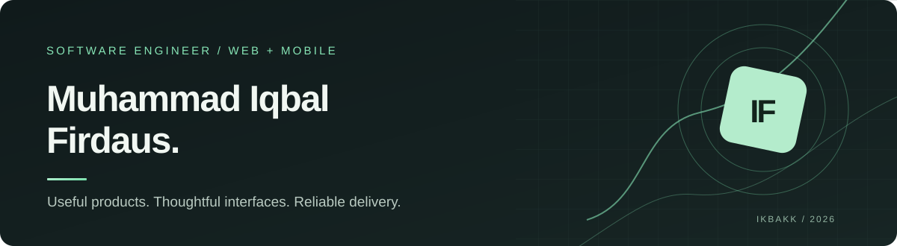

  

<table>
<tr><td width="67%" valign="top">

### Building useful software, end to end.

I'm **Muhammad Iqbal Firdaus**, a software engineer working across **web and mobile applications**. I turn product requirements into dependable interfaces, integrate backend systems, and improve applications that already serve real users.

My work spans client delivery, product engineering, and independent experiments. I care about thoughtful UX, maintainable code, and getting the important things shipped.

</td><td width="33%" valign="top">

**CURRENT FOCUS**

- Frontend & mobile engineering
- Product-oriented development
- Practical, maintainable systems

**CONNECT**

[LinkedIn](https://linkedin.com/in/ikbakk) · [Email](mailto:ikbakfir@gmail.com)

</td></tr>
</table>

---

### Selected work

<table>
<tr>
<td width="50%" valign="top">

**[Rentalin ↗](https://github.com/ikbakk/rentalin)**  
*Vehicle-rental operations platform*

Business operations and public booking in one product. Built around tenant-aware access, real-time application data, and a dedicated marketing experience.

`Next.js` `TypeScript` `Convex` `Astro`

</td>
<td width="50%" valign="top">

**[Beaconnect ↗](https://github.com/ikbakk/beaconnect)**  
*Privacy-conscious companion app*

A mutual-sharing Android experience designed around reassurance, consent, and calm interactions. Product decisions and architecture are documented alongside implementation.

`Flutter` `Firebase` `Android`

</td>
</tr>
<tr>
<td width="50%" valign="top">

**[Personal portfolio ↗](https://github.com/ikbakk/website-portofolio)**  
*An interactive project archive*

An Astro-powered personal portfolio with a distinctive visual system, progressive enhancement, accessible navigation, and project case studies.

`Astro` `TypeScript` `Tailwind CSS` `GSAP`

</td>
<td width="50%" valign="top">

**[ESP32 Ward Monitor ↗](https://github.com/ikbakk/esp32-ward-monitor)**  
*Connected systems experiment*

A medical-monitoring simulation using ESP32 and Firebase, exploring device data, alerts, and integration with web interfaces.

`ESP32` `C++` `Firebase`

</td>
</tr>
</table>

---

### How I work

**Build from a real problem** → Understand the user and the constraints before selecting technology.  
**Make it maintainable** → Separate responsibilities, reuse patterns, and avoid unnecessary complexity.  
**Ship and improve** → Validate behavior, handle edge cases, and iterate based on actual usage.

### Engineering toolkit

**Web:** React · Next.js · Astro · TypeScript  
**Mobile:** Flutter · React Native  
**Backend & data:** Node.js · NestJS · PostgreSQL · Firebase · Convex  
**Delivery:** Git · Docker · CI checks · Testing

---

  <strong>Have a product to build or a system to improve?</strong>
  
I'm open to engineering opportunities and selected collaborations.

  <a href="mailto:ikbakfir@gmail.com"><strong>Start a conversation →</strong></a>
  &nbsp;·&nbsp;
  <a href="https://linkedin.com/in/ikbakk">LinkedIn</a>

